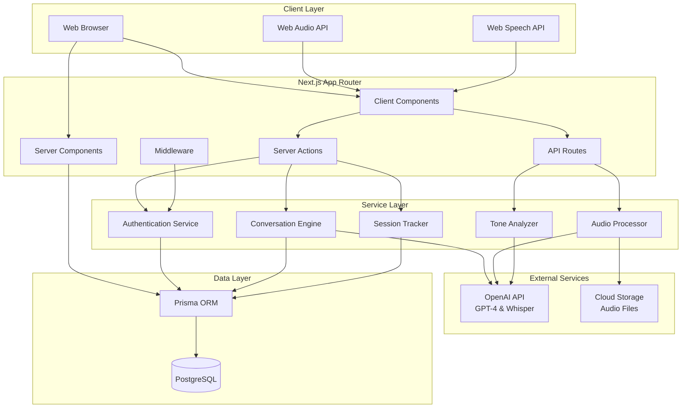
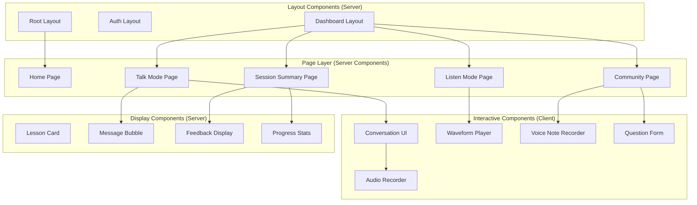
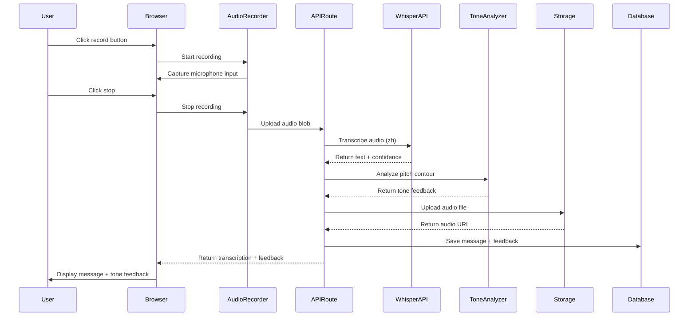

# Technical Design Document: Pinyin Talk Mandarin Learning App

## Overview

Pinyin Talk is a full-stack Mandarin Chinese learning application built with Next.js 14+ App Router, enabling personalized language instruction through AI-powered conversational practice, real-time tone analysis, listening comprehension drills, and community support. The system leverages server components for optimal performance, streaming responses for enhanced UX, and a scalable architecture supporting 100+ concurrent users.

### Technology Stack

- **Frontend**: Next.js 14+ App Router, React Server Components, TypeScript, TailwindCSS
- **Backend**: Next.js API Routes, Server Actions
- **Database**: PostgreSQL with Prisma ORM v7
- **AI Services**: OpenAI GPT-4 (conversation), Whisper API (speech-to-text)
- **Audio Processing**: Web Speech API (browser synthesis), OpenAI Whisper (recognition), Web Audio API (analysis)
- **Authentication**: NextAuth.js with credential-based authentication
- **Deployment**: Vercel (recommended) or similar platform supporting Edge Runtime
- **Storage**: Cloud storage for audio files (AWS S3, Vercel Blob, or Cloudflare R2)

### Design Principles

1. **Server-First Architecture**: Leverage React Server Components for data fetching and composition, minimizing client-side JavaScript
2. **Progressive Enhancement**: Core functionality works with JavaScript, enhanced features degrade gracefully
3. **Streaming by Default**: Use Suspense boundaries and streaming to show content progressively
4. **Type Safety**: End-to-end type safety from database to UI using Prisma and TypeScript
5. **Scalable Real-Time**: Design audio processing pipeline to handle concurrent users efficiently
6. **Accessibility**: WCAG 2.1 AA compliant with keyboard navigation and screen reader support

## Architecture

### High-Level System Architecture



### Component Architecture



## Components and Interfaces

### Frontend Component Hierarchy

#### Server Components (Default)

**Root Layout** (`app/layout.tsx`)
- Provides global styles, fonts, and metadata
- Wraps application with authentication provider
- Handles theme and internationalization setup

**Home Dashboard** (`app/(dashboard)/page.tsx`)
- Fetches user data and progress from database
- Displays personalized greeting and continue option
- Renders lesson cards with server-side data

**Talk Mode Page** (`app/(dashboard)/talk/page.tsx`)
- Initializes conversation session from database
- Streams Mei's responses using Suspense boundaries
- Wraps interactive conversation UI

**Listen Mode Page** (`app/(dashboard)/listen/page.tsx`)
- Fetches listening drill data
- Provides audio metadata and questions
- Wraps interactive player component

**Session Summary Page** (`app/(dashboard)/session/[id]/page.tsx`)
- Retrieves session results from database
- Calculates performance metrics server-side
- Displays review vocabulary with audio references

**Community Page** (`app/(dashboard)/community/page.tsx`)
- Fetches questions with server-side filtering
- Implements pagination for large datasets
- Renders question list with teacher responses

#### Client Components (Interactive)

**AudioRecorder** (`components/audio/AudioRecorder.tsx`)
```typescript
'use client'

interface AudioRecorderProps {
  onRecordingComplete: (audioBlob: Blob) => Promise<void>
  onTranscriptionReceived: (text: string, pinyin: string) => void
  disabled?: boolean
}

// Responsibilities:
// - Capture microphone input using MediaRecorder API
// - Provide visual recording indicator
// - Upload audio to API endpoint for transcription
// - Handle recording errors gracefully
```

**ConversationUI** (`components/conversation/ConversationUI.tsx`)
```typescript
'use client'

interface Message {
  id: string
  role: 'user' | 'assistant'
  content: string
  pinyin?: string
  translation?: string
  audioUrl?: string
  toneFeedback?: ToneFeedback
}

interface ConversationUIProps {
  sessionId: string
  initialMessages: Message[]
  onSendMessage: (audio: Blob) => Promise<void>
}

// Responsibilities:
// - Display conversation history with scrolling
// - Integrate AudioRecorder for user input
// - Show tone feedback inline with messages
// - Provide "Help in English" button
// - Play audio for any message
```

**WaveformPlayer** (`components/audio/WaveformPlayer.tsx`)
```typescript
'use client'

interface WaveformPlayerProps {
  audioUrl: string
  waveformData: number[]
  duration: number
  onPlaybackComplete?: () => void
}

// Responsibilities:
// - Render waveform visualization using Canvas API
// - Provide playback controls (play, pause, seek)
// - Support normal and slower playback speeds
// - Highlight current playback position
```

**VoiceNoteRecorder** (`components/community/VoiceNoteRecorder.tsx`)
```typescript
'use client'

interface VoiceNoteRecorderProps {
  onVoiceNoteReady: (audioBlob: Blob) => void
  maxDuration?: number // default 60 seconds
}

// Responsibilities:
// - Record voice notes for community questions
// - Display recording timer and waveform preview
// - Allow playback before submission
// - Upload to storage and provide URL
```

**MultipleChoiceQuiz** (`components/listening/MultipleChoiceQuiz.tsx`)
```typescript
'use client'

interface Question {
  id: string
  text: string
  options: string[]
  correctAnswer: number
}

interface MultipleChoiceQuizProps {
  questions: Question[]
  onComplete: (answers: number[]) => Promise<void>
}

// Responsibilities:
// - Display questions one at a time or all at once
// - Capture user selections
// - Provide immediate feedback on submission
// - Submit answers via server action
```

### Backend API Structure

#### API Routes (Next.js App Router)

**Audio Transcription** (`app/api/audio/transcribe/route.ts`)
```typescript
// POST /api/audio/transcribe
// Body: FormData with audio file
// Returns: { text: string, pinyin: string, confidence: number }

export async function POST(request: Request) {
  const formData = await request.formData()
  const audioFile = formData.get('audio') as Blob
  
  // Send to OpenAI Whisper API
  const transcription = await transcribeAudio(audioFile, 'zh')
  
  // Generate pinyin from Chinese text
  const pinyin = await generatePinyin(transcription.text)
  
  return NextResponse.json({
    text: transcription.text,
    pinyin,
    confidence: transcription.confidence
  })
}
```

**Tone Analysis** (`app/api/audio/analyze-tone/route.ts`)
```typescript
// POST /api/audio/analyze-tone
// Body: { audioUrl: string, expectedText: string }
// Returns: { feedback: ToneFeedback[], overallScore: number }

interface ToneFeedback {
  word: string
  pinyin: string
  expectedTone: number
  detectedTone: number
  isCorrect: boolean
  correction?: string
}

export async function POST(request: Request) {
  const { audioUrl, expectedText } = await request.json()
  
  // Analyze pitch contour using audio analysis
  const pitchData = await extractPitchContour(audioUrl)
  
  // Compare with expected tones
  const feedback = await compareTones(pitchData, expectedText)
  
  return NextResponse.json(feedback)
}
```

**AI Conversation** (`app/api/conversation/stream/route.ts`)
```typescript
// POST /api/conversation/stream
// Body: { sessionId: string, message: string, context: Message[] }
// Returns: ReadableStream (streaming response)

export async function POST(request: Request) {
  const { sessionId, message, context } = await request.json()
  
  // Fetch session and lesson context from database
  const session = await prisma.session.findUnique({
    where: { id: sessionId },
    include: { lesson: true, user: true }
  })
  
  // Stream GPT-4 response
  const stream = await streamChatCompletion({
    messages: buildConversationContext(context, session),
    userMessage: message,
    systemPrompt: buildMeiPersonaPrompt(session.lesson)
  })
  
  return new Response(stream, {
    headers: { 'Content-Type': 'text/event-stream' }
  })
}
```

**Audio Upload** (`app/api/audio/upload/route.ts`)
```typescript
// POST /api/audio/upload
// Body: FormData with audio file
// Returns: { url: string, duration: number }

export async function POST(request: Request) {
  const formData = await request.formData()
  const audioFile = formData.get('audio') as File
  
  // Validate file size and type
  validateAudioFile(audioFile)
  
  // Upload to cloud storage
  const url = await uploadToStorage(audioFile, 'voice-notes')
  
  // Extract audio duration
  const duration = await getAudioDuration(audioFile)
  
  return NextResponse.json({ url, duration })
}
```

#### Server Actions

**createSession** (`app/actions/session.ts`)
```typescript
'use server'

export async function createSession(lessonId: string, mode: 'talk' | 'listen') {
  const session = await getServerSession(authOptions)
  if (!session?.user) throw new Error('Unauthorized')
  
  const newSession = await prisma.session.create({
    data: {
      userId: session.user.id,
      lessonId,
      mode,
      status: 'active',
      startedAt: new Date()
    }
  })
  
  revalidatePath('/dashboard')
  return newSession.id
}
```

**submitAnswer** (`app/actions/listening.ts`)
```typescript
'use server'

export async function submitAnswer(
  questionId: string,
  selectedOption: number,
  sessionId: string
) {
  const question = await prisma.question.findUnique({
    where: { id: questionId }
  })
  
  const isCorrect = question?.correctAnswer === selectedOption
  
  await prisma.answer.create({
    data: {
      sessionId,
      questionId,
      selectedOption,
      isCorrect,
      answeredAt: new Date()
    }
  })
  
  return { isCorrect, correctAnswer: question?.correctAnswer }
}
```

**submitCommunityQuestion** (`app/actions/community.ts`)
```typescript
'use server'

export async function submitCommunityQuestion(
  text: string,
  voiceNoteUrl: string | null,
  level: 'beginner' | 'tones' | 'travel'
) {
  const session = await getServerSession(authOptions)
  if (!session?.user) throw new Error('Unauthorized')
  
  const question = await prisma.communityQuestion.create({
    data: {
      userId: session.user.id,
      text,
      voiceNoteUrl,
      level,
      createdAt: new Date()
    }
  })
  
  revalidatePath('/community')
  return question.id
}
```

### Service Layer

#### ConversationEngine

```typescript
// lib/services/conversationEngine.ts

interface ConversationContext {
  lesson: Lesson
  userLevel: string
  previousMessages: Message[]
}

export class ConversationEngine {
  async generateResponse(
    userMessage: string,
    context: ConversationContext
  ): Promise<string> {
    const systemPrompt = this.buildMeiPrompt(context)
    
    const completion = await openai.chat.completions.create({
      model: 'gpt-4-turbo-preview',
      messages: [
        { role: 'system', content: systemPrompt },
        ...context.previousMessages.map(m => ({
          role: m.role,
          content: m.content
        })),
        { role: 'user', content: userMessage }
      ],
      temperature: 0.8,
      max_tokens: 200
    })
    
    return completion.choices[0].message.content || ''
  }
  
  private buildMeiPrompt(context: ConversationContext): string {
    return `You are Mei (美), a friendly and encouraging Mandarin Chinese tutor. 

Your teaching style:
- Speak primarily in Mandarin Chinese with occasional English explanations
- Keep responses conversational and natural (2-3 sentences)
- Focus on the lesson theme: ${context.lesson.theme}
- Adapt to ${context.userLevel} proficiency level
- Gently correct mistakes by modeling correct usage
- Use vocabulary appropriate for the current lesson

Current lesson context: ${context.lesson.description}

Remember: Your goal is to create a supportive, realistic conversation practice environment.`
  }
  
  async streamResponse(
    userMessage: string,
    context: ConversationContext
  ): AsyncIterableIterator<string> {
    const stream = await openai.chat.completions.create({
      model: 'gpt-4-turbo-preview',
      messages: this.buildMessages(userMessage, context),
      stream: true
    })
    
    for await (const chunk of stream) {
      const content = chunk.choices[0]?.delta?.content || ''
      if (content) yield content
    }
  }
}
```

#### AudioProcessor

```typescript
// lib/services/audioProcessor.ts

export class AudioProcessor {
  async transcribe(
    audioBlob: Blob,
    language: string = 'zh'
  ): Promise<TranscriptionResult> {
    const file = new File([audioBlob], 'audio.webm', { type: 'audio/webm' })
    
    const transcription = await openai.audio.transcriptions.create({
      file,
      model: 'whisper-1',
      language,
      response_format: 'verbose_json'
    })
    
    return {
      text: transcription.text,
      confidence: transcription.segments?.[0]?.confidence || 0,
      duration: transcription.duration
    }
  }
  
  async synthesize(
    text: string,
    voice: 'alloy' | 'nova' = 'nova'
  ): Promise<ArrayBuffer> {
    const mp3 = await openai.audio.speech.create({
      model: 'tts-1',
      voice,
      input: text,
      speed: 1.0
    })
    
    return mp3.arrayBuffer()
  }
  
  async uploadAudio(audioBlob: Blob, prefix: string): Promise<string> {
    // Implementation depends on storage provider (S3, Vercel Blob, etc.)
    const fileName = `${prefix}/${Date.now()}-${crypto.randomUUID()}.webm`
    const url = await storage.upload(fileName, audioBlob)
    return url
  }
}
```

#### ToneAnalyzer

```typescript
// lib/services/toneAnalyzer.ts

interface PitchPoint {
  time: number
  frequency: number
}

interface ToneAnalysis {
  word: string
  pinyin: string
  expectedTone: number
  detectedTone: number
  isCorrect: boolean
  correction?: string
}

export class ToneAnalyzer {
  private readonly TONE_PATTERNS = {
    1: { description: 'flat high tone', range: [0.9, 1.1] },
    2: { description: 'rising tone', range: [0.7, 1.3] },
    3: { description: 'dipping tone', range: [0.6, 0.8, 1.1] },
    4: { description: 'falling tone', range: [1.3, 0.7] }
  }
  
  async analyze(
    audioUrl: string,
    expectedText: string
  ): Promise<ToneAnalysis[]> {
    // Step 1: Transcribe with Whisper to get word-level timestamps
    const transcription = await this.transcribeWithTimestamps(audioUrl)
    
    // Step 2: Extract pitch contour from audio
    const pitchData = await this.extractPitchContour(audioUrl)
    
    // Step 3: Segment pitch data by word timestamps
    const wordPitches = this.segmentByWords(pitchData, transcription.words)
    
    // Step 4: Get expected tones from text
    const expectedTones = await this.getExpectedTones(expectedText)
    
    // Step 5: Compare detected vs expected
    const analyses = this.compareWordTones(wordPitches, expectedTones)
    
    return analyses
  }
  
  private async extractPitchContour(audioUrl: string): Promise<PitchPoint[]> {
    // Use Web Audio API or external service for pitch detection
    // This is a simplified representation
    // In production, consider using libraries like aubio or CREPE
    
    const audioBuffer = await this.loadAudioBuffer(audioUrl)
    const pitchData: PitchPoint[] = []
    
    // Simplified pitch extraction (would use FFT and autocorrelation in practice)
    const sampleRate = audioBuffer.sampleRate
    const frameSize = 2048
    const hopSize = 512
    
    for (let i = 0; i < audioBuffer.length - frameSize; i += hopSize) {
      const frame = audioBuffer.getChannelData(0).slice(i, i + frameSize)
      const frequency = this.detectPitch(frame, sampleRate)
      const time = i / sampleRate
      
      pitchData.push({ time, frequency })
    }
    
    return pitchData
  }
  
  private detectToneType(pitchContour: number[]): number {
    // Normalize pitch values
    const normalized = this.normalizePitch(pitchContour)
    
    // Calculate trend indicators
    const startValue = normalized[0]
    const midValue = normalized[Math.floor(normalized.length / 2)]
    const endValue = normalized[normalized.length - 1]
    const range = Math.max(...normalized) - Math.min(...normalized)
    
    // Classify tone based on pitch contour shape
    if (range < 0.2) return 1 // Flat tone
    if (endValue > startValue + 0.2) return 2 // Rising
    if (midValue < startValue && endValue > midValue) return 3 // Dipping
    if (endValue < startValue - 0.2) return 4 // Falling
    
    return 0 // Neutral/unclear
  }
  
  private generateCorrection(
    word: string,
    pinyin: string,
    expectedTone: number,
    detectedTone: number
  ): string {
    const toneDesc = this.TONE_PATTERNS[expectedTone]?.description || 'correct tone'
    return `The word "${word}" (${pinyin}) should use the ${expectedTone} tone (${toneDesc}). You used a ${detectedTone} tone. Try again with a ${toneDesc.split(' ')[0]} pitch contour.`
  }
}
```

#### SessionTracker

```typescript
// lib/services/sessionTracker.ts

export class SessionTracker {
  async recordMessage(
    sessionId: string,
    role: 'user' | 'assistant',
    content: string,
    metadata: {
      pinyin?: string
      translation?: string
      audioUrl?: string
      toneFeedback?: ToneFeedback[]
    }
  ): Promise<void> {
    await prisma.message.create({
      data: {
        sessionId,
        role,
        content,
        ...metadata,
        createdAt: new Date()
      }
    })
  }
  
  async completeSession(sessionId: string): Promise<SessionSummary> {
    // Calculate performance metrics
    const messages = await prisma.message.findMany({
      where: { sessionId }
    })
    
    const userMessages = messages.filter(m => m.role === 'user')
    const toneFeedback = userMessages.flatMap(m => m.toneFeedback || [])
    
    const correctTones = toneFeedback.filter(f => f.isCorrect).length
    const totalTones = toneFeedback.length
    const toneAccuracy = totalTones > 0 ? correctTones / totalTones : 1
    
    // Update session
    await prisma.session.update({
      where: { id: sessionId },
      data: {
        status: 'completed',
        completedAt: new Date(),
        toneAccuracy,
        messageCount: userMessages.length
      }
    })
    
    return {
      toneAccuracy,
      messageCount: userMessages.length,
      duration: this.calculateDuration(messages),
      reviewWords: this.extractReviewWords(messages)
    }
  }
  
  async getUserProgress(userId: string): Promise<UserProgress> {
    const sessions = await prisma.session.findMany({
      where: { userId, status: 'completed' },
      orderBy: { completedAt: 'desc' }
    })
    
    return {
      totalSessions: sessions.length,
      averageToneAccuracy: this.calculateAverage(
        sessions.map(s => s.toneAccuracy)
      ),
      totalPracticeTime: sessions.reduce((sum, s) => sum + (s.duration || 0), 0),
      recentSessions: sessions.slice(0, 5)
    }
  }
}
```

## Data Models

### Prisma Schema

```prisma
// prisma/schema.prisma

generator client {
  provider = "prisma-client-js"
}

datasource db {
  provider = "postgresql"
  url      = env("DATABASE_URL")
}

// ============================================
// Authentication & User Management
// ============================================

model User {
  id                String              @id @default(cuid())
  email             String              @unique
  password          String
  name              String
  createdAt         DateTime            @default(now())
  updatedAt         DateTime            @updatedAt
  
  // User preferences
  proficiencyLevel  String              @default("beginner") // beginner, intermediate, advanced
  preferredTopics   String[]            @default([])
  totalPracticeTime Int                 @default(0) // in seconds
  
  // Relations
  sessions          Session[]
  communityQuestions CommunityQuestion[]
  answers           Answer[]
  
  @@index([email])
}

// ============================================
// Lesson & Content Management
// ============================================

model Lesson {
  id                String              @id @default(cuid())
  title             String
  titleChinese      String
  theme             String              // "asking-directions", "small-talk", "taxi-travel"
  description       String              @db.Text
  level             String              // "beginner", "intermediate", "advanced"
  objectives        String[]
  vocabulary        Json                // Array of {word, pinyin, translation, audioUrl}
  dialogues         Json?               // Optional pre-scripted dialogues
  order             Int                 @default(0)
  isActive          Boolean             @default(true)
  createdAt         DateTime            @default(now())
  updatedAt         DateTime            @updatedAt
  
  // Relations
  sessions          Session[]
  listeningDrills   ListeningDrill[]
  
  @@index([theme, level])
  @@index([order])
}

// ============================================
// Practice Sessions
// ============================================

model Session {
  id                String              @id @default(cuid())
  userId            String
  lessonId          String?
  mode              String              // "talk", "listen"
  status            String              @default("active") // active, completed, abandoned
  
  // Timestamps
  startedAt         DateTime            @default(now())
  completedAt       DateTime?
  duration          Int?                // in seconds
  
  // Performance metrics
  toneAccuracy      Float?              @default(0)
  messageCount      Int                 @default(0)
  questionsAnswered Int                 @default(0)
  correctAnswers    Int                 @default(0)
  
  // Relations
  user              User                @relation(fields: [userId], references: [id], onDelete: Cascade)
  lesson            Lesson?             @relation(fields: [lessonId], references: [id], onDelete: SetNull)
  messages          Message[]
  answers           Answer[]
  
  @@index([userId, status])
  @@index([lessonId])
  @@index([startedAt])
}

// ============================================
// Conversation Messages
// ============================================

model Message {
  id                String              @id @default(cuid())
  sessionId         String
  role              String              // "user", "assistant"
  content           String              @db.Text
  pinyin            String?             @db.Text
  translation       String?             @db.Text
  audioUrl          String?
  
  // Tone analysis results
  toneFeedback      Json?               // Array of ToneFeedback objects
  
  createdAt         DateTime            @default(now())
  
  // Relations
  session           Session             @relation(fields: [sessionId], references: [id], onDelete: Cascade)
  
  @@index([sessionId, createdAt])
}

// ============================================
// Listening Comprehension
// ============================================

model ListeningDrill {
  id                String              @id @default(cuid())
  lessonId          String?
  title             String
  titleChinese      String
  audioUrl          String
  transcript        String              @db.Text
  transcriptPinyin  String              @db.Text
  duration          Int                 // in seconds
  waveformData      Json                // Array of amplitude values for visualization
  level             String              // "beginner", "intermediate", "advanced"
  createdAt         DateTime            @default(now())
  
  // Relations
  lesson            Lesson?             @relation(fields: [lessonId], references: [id], onDelete: SetNull)
  questions         Question[]
  
  @@index([lessonId])
  @@index([level])
}

model Question {
  id                String              @id @default(cuid())
  drillId           String
  text              String              @db.Text
  options           String[]            // Array of 3-5 options
  correctAnswer     Int                 // Index of correct option (0-based)
  order             Int                 @default(0)
  
  // Relations
  drill             ListeningDrill      @relation(fields: [drillId], references: [id], onDelete: Cascade)
  answers           Answer[]
  
  @@index([drillId, order])
}

model Answer {
  id                String              @id @default(cuid())
  sessionId         String
  questionId        String
  userId            String
  selectedOption    Int
  isCorrect         Boolean
  answeredAt        DateTime            @default(now())
  
  // Relations
  session           Session             @relation(fields: [sessionId], references: [id], onDelete: Cascade)
  question          Question            @relation(fields: [questionId], references: [id], onDelete: Cascade)
  user              User                @relation(fields: [userId], references: [id], onDelete: Cascade)
  
  @@index([sessionId])
  @@index([questionId])
  @@index([userId])
}

// ============================================
// Community & Support
// ============================================

model CommunityQuestion {
  id                String              @id @default(cuid())
  userId            String
  text              String              @db.Text
  voiceNoteUrl      String?
  level             String              // "beginner", "tones", "travel"
  status            String              @default("open") // open, answered, closed
  createdAt         DateTime            @default(now())
  
  // Relations
  user              User                @relation(fields: [userId], references: [id], onDelete: Cascade)
  responses         TeacherResponse[]
  
  @@index([level, status])
  @@index([createdAt])
}

model TeacherResponse {
  id                String              @id @default(cuid())
  questionId        String
  teacherName       String
  text              String              @db.Text
  voiceNoteUrl      String?
  examplePinyin     String?
  createdAt         DateTime            @default(now())
  
  // Relations
  question          CommunityQuestion   @relation(fields: [questionId], references: [id], onDelete: Cascade)
  
  @@index([questionId])
}
```

### Database Design Rationale

**Indexing Strategy**:
- Foreign keys are indexed automatically by PostgreSQL
- Additional indexes on frequently queried fields (email, session status, timestamps)
- Composite indexes for common query patterns (lessonId + level, userId + status)

**Relationship Design**:
- `onDelete: Cascade` for dependent data (messages, answers) to maintain referential integrity
- `onDelete: SetNull` for optional relationships (lesson in session) to preserve historical data
- `onDelete: Restrict` would be used for protected entities (not applicable here)

**JSON Fields**:
- Used for flexible data structures (vocabulary, toneFeedback, waveformData)
- Allows schema evolution without migrations for non-critical data
- Trade-off: Less queryable but more flexible than normalized tables

**Performance Considerations**:
- Session and Message tables will grow large: consider partitioning by date after 1M+ records
- Audio URLs stored as strings (not BLOBs) for scalability
- Aggregated metrics (toneAccuracy, messageCount) denormalized for faster queries

## Audio Processing Pipeline

### Architecture



### Recording Implementation

**Client-Side Recording** (`lib/hooks/useAudioRecorder.ts`)

```typescript
'use client'

export function useAudioRecorder() {
  const [isRecording, setIsRecording] = useState(false)
  const [audioBlob, setAudioBlob] = useState<Blob | null>(null)
  const mediaRecorderRef = useRef<MediaRecorder | null>(null)
  const chunksRef = useRef<Blob[]>([])
  
  const startRecording = async () => {
    try {
      const stream = await navigator.mediaDevices.getUserMedia({ audio: true })
      
      // Use webm format for broad compatibility
      const mediaRecorder = new MediaRecorder(stream, {
        mimeType: 'audio/webm;codecs=opus'
      })
      
      mediaRecorder.ondataavailable = (event) => {
        if (event.data.size > 0) {
          chunksRef.current.push(event.data)
        }
      }
      
      mediaRecorder.onstop = () => {
        const blob = new Blob(chunksRef.current, { type: 'audio/webm' })
        setAudioBlob(blob)
        chunksRef.current = []
        
        // Stop all tracks to release microphone
        stream.getTracks().forEach(track => track.stop())
      }
      
      mediaRecorderRef.current = mediaRecorder
      mediaRecorder.start()
      setIsRecording(true)
    } catch (error) {
      console.error('Failed to start recording:', error)
      throw new Error('Microphone access denied or not available')
    }
  }
  
  const stopRecording = () => {
    if (mediaRecorderRef.current && isRecording) {
      mediaRecorderRef.current.stop()
      setIsRecording(false)
    }
  }
  
  return {
    isRecording,
    audioBlob,
    startRecording,
    stopRecording
  }
}
```

### Speech Recognition Flow

**Primary: OpenAI Whisper API**
- High accuracy for Mandarin Chinese
- Returns text with confidence scores
- Handles background noise well
- Supports word-level timestamps (for tone analysis)

**Fallback: Web Speech API**
- Browser-native, no API costs
- Lower accuracy for Mandarin
- Works offline
- Use as graceful degradation when Whisper API fails

### Text-to-Speech Strategy

**Primary: OpenAI TTS API**
- Natural-sounding Mandarin voices
- Correct tone pronunciation
- Generate on-demand, cache results

**Supplementary: Web Speech API**
- Browser-native synthesis for simple playback
- Variable speed control (0.5x - 2x)
- Use for lesson vocabulary playback

### Waveform Visualization

```typescript
// lib/utils/waveform.ts

export function generateWaveform(
  audioBuffer: AudioBuffer,
  targetWidth: number = 1000
): number[] {
  const rawData = audioBuffer.getChannelData(0)
  const samples = targetWidth
  const blockSize = Math.floor(rawData.length / samples)
  const waveform: number[] = []
  
  for (let i = 0; i < samples; i++) {
    const start = blockSize * i
    let sum = 0
    
    // Calculate RMS for this block
    for (let j = 0; j < blockSize; j++) {
      sum += rawData[start + j] ** 2
    }
    
    const rms = Math.sqrt(sum / blockSize)
    waveform.push(rms)
  }
  
  // Normalize to 0-1 range
  const max = Math.max(...waveform)
  return waveform.map(v => v / max)
}

export function renderWaveform(
  canvas: HTMLCanvasElement,
  waveformData: number[],
  progress: number = 0
) {
  const ctx = canvas.getContext('2d')
  if (!ctx) return
  
  const width = canvas.width
  const height = canvas.height
  const barWidth = width / waveformData.length
  const progressX = width * progress
  
  ctx.clearRect(0, 0, width, height)
  
  waveformData.forEach((value, index) => {
    const barHeight = value * height * 0.8
    const x = index * barWidth
    const y = (height - barHeight) / 2
    
    // Color based on playback progress
    ctx.fillStyle = x < progressX ? '#3b82f6' : '#94a3b8'
    ctx.fillRect(x, y, barWidth - 1, barHeight)
  })
}
```

## Security and Authentication

### Authentication Strategy

**NextAuth.js Configuration** (`app/api/auth/[...nextauth]/route.ts`)

```typescript
import NextAuth, { AuthOptions } from 'next-auth'
import CredentialsProvider from 'next-auth/providers/credentials'
import { PrismaAdapter } from '@auth/prisma-adapter'
import { prisma } from '@/lib/prisma'
import bcrypt from 'bcryptjs'

export const authOptions: AuthOptions = {
  adapter: PrismaAdapter(prisma),
  providers: [
    CredentialsProvider({
      name: 'Credentials',
      credentials: {
        email: { label: "Email", type: "email" },
        password: { label: "Password", type: "password" }
      },
      async authorize(credentials) {
        if (!credentials?.email || !credentials?.password) {
          return null
        }
        
        const user = await prisma.user.findUnique({
          where: { email: credentials.email }
        })
        
        if (!user) {
          return null
        }
        
        const isPasswordValid = await bcrypt.compare(
          credentials.password,
          user.password
        )
        
        if (!isPasswordValid) {
          return null
        }
        
        return {
          id: user.id,
          email: user.email,
          name: user.name
        }
      }
    })
  ],
  session: {
    strategy: 'jwt',
    maxAge: 30 * 24 * 60 * 60 // 30 days
  },
  pages: {
    signIn: '/auth/signin',
    signOut: '/auth/signout',
    error: '/auth/error'
  },
  callbacks: {
    async jwt({ token, user }) {
      if (user) {
        token.id = user.id
      }
      return token
    },
    async session({ session, token }) {
      if (session.user) {
        session.user.id = token.id as string
      }
      return session
    }
  }
}

const handler = NextAuth(authOptions)
export { handler as GET, handler as POST }
```

### Middleware Protection

```typescript
// middleware.ts

import { withAuth } from 'next-auth/middleware'

export default withAuth({
  pages: {
    signIn: '/auth/signin'
  }
})

export const config = {
  matcher: [
    '/dashboard/:path*',
    '/talk/:path*',
    '/listen/:path*',
    '/community/:path*',
    '/api/conversation/:path*',
    '/api/audio/:path*'
  ]
}
```

### API Route Protection

```typescript
// lib/auth/apiAuth.ts

export async function requireAuth(request: Request) {
  const session = await getServerSession(authOptions)
  
  if (!session?.user) {
    return NextResponse.json(
      { error: 'Unauthorized' },
      { status: 401 }
    )
  }
  
  return session
}

// Usage in API route
export async function POST(request: Request) {
  const session = await requireAuth(request)
  if (session instanceof NextResponse) return session // Error response
  
  // Proceed with authenticated logic
  const userId = session.user.id
  // ...
}
```

### Data Security

**Password Hashing**:
```typescript
import bcrypt from 'bcryptjs'

// Registration
const hashedPassword = await bcrypt.hash(password, 12)

// Verification
const isValid = await bcrypt.compare(password, user.password)
```

**Environment Variables**:
```env
# .env.local
DATABASE_URL="postgresql://..."
NEXTAUTH_SECRET="generate-with-openssl-rand-base64-32"
NEXTAUTH_URL="http://localhost:3000"
OPENAI_API_KEY="sk-..."
STORAGE_ACCESS_KEY="..."
STORAGE_SECRET_KEY="..."
```

**Input Validation**:
```typescript
import { z } from 'zod'

const MessageSchema = z.object({
  sessionId: z.string().cuid(),
  content: z.string().min(1).max(1000),
  audioUrl: z.string().url().optional()
})

export async function POST(request: Request) {
  const body = await request.json()
  
  try {
    const validated = MessageSchema.parse(body)
    // Proceed with validated data
  } catch (error) {
    return NextResponse.json(
      { error: 'Invalid input' },
      { status: 400 }
    )
  }
}
```

**Rate Limiting**:
```typescript
// lib/rateLimit.ts
import { Ratelimit } from '@upstash/ratelimit'
import { Redis } from '@upstash/redis'

const ratelimit = new Ratelimit({
  redis: Redis.fromEnv(),
  limiter: Ratelimit.slidingWindow(10, '1 m'), // 10 requests per minute
  analytics: true
})

export async function checkRateLimit(identifier: string) {
  const { success, remaining } = await ratelimit.limit(identifier)
  
  if (!success) {
    throw new Error('Rate limit exceeded')
  }
  
  return remaining
}
```

## Performance Optimization Strategies

### Server Components & Streaming

**Streaming Conversation Responses**:
```typescript
// app/(dashboard)/talk/page.tsx

import { Suspense } from 'react'

export default async function TalkPage() {
  return (
    <div>
      <Suspense fallback={<ConversationSkeleton />}>
        <ConversationHistory sessionId={sessionId} />
      </Suspense>
      
      <ConversationInput />
    </div>
  )
}

// ConversationHistory fetches data but doesn't block the input UI
async function ConversationHistory({ sessionId }: { sessionId: string }) {
  const messages = await prisma.message.findMany({
    where: { sessionId },
    orderBy: { createdAt: 'asc' }
  })
  
  return <MessageList messages={messages} />
}
```

### Database Query Optimization

**Connection Pooling**:
```typescript
// lib/prisma.ts

import { PrismaClient } from '@prisma/client'

const globalForPrisma = global as unknown as { prisma: PrismaClient }

export const prisma = globalForPrisma.prisma || new PrismaClient({
  log: process.env.NODE_ENV === 'development' ? ['query', 'error', 'warn'] : ['error'],
  datasources: {
    db: {
      url: process.env.DATABASE_URL
    }
  }
})

if (process.env.NODE_ENV !== 'production') globalForPrisma.prisma = prisma
```

**Efficient Queries with Select**:
```typescript
// Only fetch needed fields
const sessions = await prisma.session.findMany({
  where: { userId },
  select: {
    id: true,
    lessonId: true,
    status: true,
    toneAccuracy: true,
    completedAt: true,
    lesson: {
      select: {
        title: true,
        titleChinese: true
      }
    }
  },
  orderBy: { startedAt: 'desc' },
  take: 10
})
```

**Pagination for Large Datasets**:
```typescript
// Cursor-based pagination for community questions
export async function getCommunityQuestions(
  cursor?: string,
  take: number = 20
) {
  const questions = await prisma.communityQuestion.findMany({
    take: take + 1, // Fetch one extra to check if there are more
    ...(cursor && {
      cursor: { id: cursor },
      skip: 1 // Skip the cursor
    }),
    include: {
      user: {
        select: { name: true }
      },
      responses: {
        take: 1,
        orderBy: { createdAt: 'desc' }
      }
    },
    orderBy: { createdAt: 'desc' }
  })
  
  const hasMore = questions.length > take
  const items = hasMore ? questions.slice(0, -1) : questions
  
  return {
    items,
    nextCursor: hasMore ? items[items.length - 1].id : null
  }
}
```

### Caching Strategy

**React Server Component Caching**:
```typescript
import { cache } from 'react'

// Cache function results for the duration of a request
export const getLessons = cache(async () => {
  return await prisma.lesson.findMany({
    where: { isActive: true },
    orderBy: { order: 'asc' }
  })
})
```

**Next.js Route Segment Config**:
```typescript
// app/(dashboard)/page.tsx

// Revalidate every 5 minutes
export const revalidate = 300

// For static generation with dynamic data
export const dynamic = 'force-dynamic' // or 'auto'
```

**Redis Caching for API Responses**:
```typescript
// lib/cache.ts

import { Redis } from '@upstash/redis'

const redis = Redis.fromEnv()

export async function getCached<T>(
  key: string,
  fetcher: () => Promise<T>,
  ttl: number = 3600
): Promise<T> {
  // Try to get from cache
  const cached = await redis.get<T>(key)
  if (cached) return cached
  
  // Fetch and cache
  const data = await fetcher()
  await redis.set(key, data, { ex: ttl })
  
  return data
}

// Usage
const lessons = await getCached(
  'lessons:active',
  async () => await prisma.lesson.findMany({ where: { isActive: true } }),
  300 // 5 minutes
)
```

### Audio File Optimization

**Compression & Format**:
- Record in WebM with Opus codec (efficient, widely supported)
- Convert to MP3 for long-term storage (smaller file size)
- Use bitrate: 64kbps for speech (sufficient quality, 4MB per 10 min)

**Lazy Loading Audio**:
```typescript
// Only load audio when user clicks play
<audio
  preload="none"
  src={audioUrl}
  onPlay={handlePlay}
/>
```

**CDN for Audio Files**:
- Store audio files in cloud storage with CDN (CloudFront, Cloudflare)
- Use signed URLs for private audio (user recordings)
- Set appropriate cache headers (1 year for lesson audio)

### Bundle Size Optimization

**Dynamic Imports for Heavy Components**:
```typescript
import dynamic from 'next/dynamic'

const WaveformPlayer = dynamic(
  () => import('@/components/audio/WaveformPlayer'),
  {
    ssr: false, // Audio processing only works client-side
    loading: () => <Spinner />
  }
)
```

**Tree Shaking & Code Splitting**:
```typescript
// Import only what you need
import { startOfDay, format } from 'date-fns' // Not: import * as dateFns

// Automatic code splitting per route with App Router
// Each page.tsx generates a separate chunk
```

### Monitoring & Observability

**Performance Metrics**:
```typescript
// lib/monitoring.ts

export function trackMetric(name: string, value: number, tags?: Record<string, string>) {
  if (process.env.NODE_ENV === 'production') {
    // Send to monitoring service (Vercel Analytics, Datadog, etc.)
    console.log(`METRIC: ${name}=${value}`, tags)
  }
}

// Usage
const start = Date.now()
const result = await toneAnalyzer.analyze(audioUrl, text)
trackMetric('tone_analysis_duration_ms', Date.now() - start, {
  audio_duration: result.duration.toString()
})
```

**Error Tracking**:
```typescript
// lib/errors.ts

export function captureException(error: Error, context?: Record<string, any>) {
  console.error('Exception:', error, context)
  
  // In production, send to error tracking service (Sentry, etc.)
  if (process.env.NODE_ENV === 'production') {
    // Sentry.captureException(error, { extra: context })
  }
}
```

## Error Handling

### Global Error Boundaries

```typescript
// app/error.tsx

'use client'

export default function Error({
  error,
  reset
}: {
  error: Error & { digest?: string }
  reset: () => void
}) {
  useEffect(() => {
    captureException(error)
  }, [error])
  
  return (
    <div className="flex min-h-screen items-center justify-center">
      <div className="text-center">
        <h2 className="text-2xl font-semibold">Something went wrong</h2>
        <p className="mt-2 text-gray-600">
          We're sorry for the inconvenience. Please try again.
        </p>
        <button
          onClick={reset}
          className="mt-4 rounded bg-blue-500 px-4 py-2 text-white"
        >
          Try again
        </button>
      </div>
    </div>
  )
}
```

### API Error Responses

```typescript
// lib/errors/apiErrors.ts

export class APIError extends Error {
  constructor(
    public statusCode: number,
    message: string,
    public code?: string
  ) {
    super(message)
    this.name = 'APIError'
  }
}

export function handleAPIError(error: unknown): NextResponse {
  if (error instanceof APIError) {
    return NextResponse.json(
      { error: error.message, code: error.code },
      { status: error.statusCode }
    )
  }
  
  if (error instanceof z.ZodError) {
    return NextResponse.json(
      { error: 'Invalid input', details: error.errors },
      { status: 400 }
    )
  }
  
  console.error('Unexpected error:', error)
  
  return NextResponse.json(
    { error: 'Internal server error' },
    { status: 500 }
  )
}

// Usage in API routes
try {
  // ... API logic
} catch (error) {
  return handleAPIError(error)
}
```

### Graceful Degradation

**Audio Recording Fallback**:
```typescript
try {
  await startRecording()
} catch (error) {
  if (error.name === 'NotAllowedError') {
    showError('Please allow microphone access in your browser settings')
  } else if (error.name === 'NotFoundError') {
    showError('No microphone found. Please connect a microphone.')
  } else {
    showError('Unable to record audio. Please try typing your message instead.')
    showTextInputFallback()
  }
}
```

**API Timeout Handling**:
```typescript
async function fetchWithTimeout<T>(
  promise: Promise<T>,
  timeoutMs: number = 10000
): Promise<T> {
  const timeout = new Promise<never>((_, reject) =>
    setTimeout(() => reject(new Error('Request timeout')), timeoutMs)
  )
  
  return Promise.race([promise, timeout])
}

// Usage
try {
  const response = await fetchWithTimeout(
    openai.chat.completions.create({...}),
    8000 // 8 second timeout
  )
} catch (error) {
  if (error.message === 'Request timeout') {
    return 'I'm having trouble connecting right now. Please try again.'
  }
  throw error
}
```

## Testing Strategy

### Unit Testing

**Core Business Logic** (Services, Utilities):
- ToneAnalyzer: Test tone detection algorithm with sample pitch data
- AudioProcessor: Test audio format conversion and validation
- ConversationEngine: Test prompt generation and context building
- Use Jest for JavaScript/TypeScript testing

**Example Test**:
```typescript
// __tests__/services/toneAnalyzer.test.ts

describe('ToneAnalyzer', () => {
  describe('detectToneType', () => {
    it('should detect flat tone (tone 1)', () => {
      const flatPitch = [100, 101, 100, 99, 100, 101]
      const tone = analyzer.detectToneType(flatPitch)
      expect(tone).toBe(1)
    })
    
    it('should detect rising tone (tone 2)', () => {
      const risingPitch = [80, 85, 95, 105, 115, 120]
      const tone = analyzer.detectToneType(risingPitch)
      expect(tone).toBe(2)
    })
    
    it('should detect dipping tone (tone 3)', () => {
      const dippingPitch = [100, 90, 80, 85, 95, 105]
      const tone = analyzer.detectToneType(dippingPitch)
      expect(tone).toBe(3)
    })
    
    it('should detect falling tone (tone 4)', () => {
      const fallingPitch = [120, 110, 95, 85, 75, 70]
      const tone = analyzer.detectToneType(fallingPitch)
      expect(tone).toBe(4)
    })
  })
})
```

### Integration Testing

**API Routes**:
- Test authentication flow
- Test audio upload and transcription
- Test conversation streaming
- Use Vitest or Jest with supertest

**Database Operations**:
- Test Prisma queries with test database
- Test cascade deletes and referential integrity
- Use Prisma's built-in test utilities

**Example Test**:
```typescript
// __tests__/api/audio/transcribe.test.ts

describe('POST /api/audio/transcribe', () => {
  it('should transcribe Mandarin audio and return text with pinyin', async () => {
    const audioBlob = await loadTestAudio('test-audio-zh.webm')
    const formData = new FormData()
    formData.append('audio', audioBlob)
    
    const response = await fetch('http://localhost:3000/api/audio/transcribe', {
      method: 'POST',
      body: formData,
      headers: {
        'Authorization': `Bearer ${testToken}`
      }
    })
    
    expect(response.status).toBe(200)
    const data = await response.json()
    expect(data).toHaveProperty('text')
    expect(data).toHaveProperty('pinyin')
    expect(data.confidence).toBeGreaterThan(0.5)
  })
  
  it('should return 401 without authentication', async () => {
    const response = await fetch('http://localhost:3000/api/audio/transcribe', {
      method: 'POST'
    })
    
    expect(response.status).toBe(401)
  })
})
```

### End-to-End Testing

**Critical User Flows**:
- User registration and sign in
- Complete a conversation session
- Complete a listening drill
- Post a community question

**Tools**: Playwright or Cypress

**Example Test**:
```typescript
// e2e/conversation.spec.ts

test('user can complete a conversation practice session', async ({ page }) => {
  // Sign in
  await page.goto('/auth/signin')
  await page.fill('input[name="email"]', 'test@example.com')
  await page.fill('input[name="password"]', 'password123')
  await page.click('button[type="submit"]')
  
  // Navigate to talk mode
  await page.click('text=Talk with Mei')
  await expect(page).toHaveURL(/\/talk/)
  
  // Start conversation (mock audio recording)
  await page.click('button[aria-label="Record audio"]')
  await page.waitForTimeout(2000) // Simulate recording
  await page.click('button[aria-label="Stop recording"]')
  
  // Wait for Mei's response
  await expect(page.locator('[data-role="assistant"]').first()).toBeVisible()
  
  // Verify tone feedback appears
  await expect(page.locator('[data-testid="tone-feedback"]')).toBeVisible()
  
  // End session
  await page.click('text=End session')
  await expect(page).toHaveURL(/\/session/)
  
  // Verify summary appears
  await expect(page.locator('text=Session Complete')).toBeVisible()
})
```

### Performance Testing

**Load Testing**:
- Simulate 100+ concurrent users
- Test database query performance under load
- Test API response times
- Use k6 or Artillery

**Example Load Test**:
```javascript
// load-test/conversation.js (k6)

import http from 'k6/http'
import { check, sleep } from 'k6'

export const options = {
  stages: [
    { duration: '2m', target: 50 },  // Ramp up to 50 users
    { duration: '5m', target: 100 }, // Stay at 100 users
    { duration: '2m', target: 0 }    // Ramp down
  ],
  thresholds: {
    http_req_duration: ['p(95)<3000'], // 95% of requests under 3s
    http_req_failed: ['rate<0.05']     // Less than 5% failure rate
  }
}

export default function () {
  const payload = JSON.stringify({
    sessionId: 'test-session',
    message: '你好，我想学习中文'
  })
  
  const response = http.post('http://localhost:3000/api/conversation/stream', payload, {
    headers: {
      'Content-Type': 'application/json',
      'Authorization': `Bearer ${__ENV.TEST_TOKEN}`
    }
  })
  
  check(response, {
    'status is 200': (r) => r.status === 200,
    'response time OK': (r) => r.timings.duration < 3000
  })
  
  sleep(1)
}
```

---

## Deployment Architecture

### Infrastructure

**Recommended Platform**: Vercel
- Native Next.js support with zero configuration
- Edge runtime for API routes (low latency globally)
- Automatic HTTPS and CDN
- Environment variable management
- PostgreSQL via Vercel Postgres or external (Neon, Supabase)

**Alternative**: Self-hosted (Docker + Kubernetes)
- Greater control and cost optimization at scale
- Requires DevOps expertise
- More complex monitoring and logging setup

### Environment Configuration

```bash
# Production environment variables
DATABASE_URL="postgresql://..."
NEXTAUTH_SECRET="..."
NEXTAUTH_URL="${NEXT_PUBLIC_SITE_URL}"
OPENAI_API_KEY="sk-..."
STORAGE_URL="${NEXT_PUBLIC_SITE_URL}"
STORAGE_ACCESS_KEY="..."
STORAGE_SECRET_KEY="..."
REDIS_URL="redis://..."
```

### Database Migration Strategy

```bash
# Development
npx prisma migrate dev --name add_community_tables

# Production (run in CI/CD pipeline)
npx prisma migrate deploy
```

### Monitoring & Logging

**Application Monitoring**:
- Vercel Analytics for frontend performance
- Custom API metrics (response time, error rate, throughput)
- Database query performance (Prisma middleware)

**Error Tracking**:
- Sentry for exception tracking
- Log aggregation (Datadog, Logtail, or Vercel Logs)

**Alerts**:
- API error rate > 5%
- Database connection pool exhaustion
- OpenAI API failures
- Audio storage quota exceeded

### Scaling Considerations

**Horizontal Scaling**:
- Vercel automatically scales serverless functions
- Database connection pooling (use PgBouncer if needed)
- Redis for distributed caching and rate limiting

**Vertical Optimization**:
- Optimize database queries (use EXPLAIN ANALYZE)
- Implement caching at multiple layers
- Use CDN for static assets and audio files

**Cost Optimization**:
- Cache OpenAI TTS responses (lesson audio)
- Compress audio files before storage
- Implement audio file lifecycle (delete after 30 days for user recordings)
- Use batch processing for non-time-critical operations

---

## Appendix

### File Structure

```
pinyin-talk/
├── app/
│   ├── (auth)/
│   │   ├── signin/
│   │   │   └── page.tsx
│   │   └── signup/
│   │       └── page.tsx
│   ├── (dashboard)/
│   │   ├── layout.tsx
│   │   ├── page.tsx                    # Home dashboard
│   │   ├── talk/
│   │   │   └── page.tsx                # Conversation mode
│   │   ├── listen/
│   │   │   └── page.tsx                # Listening drills
│   │   ├── community/
│   │   │   └── page.tsx                # Community Q&A
│   │   └── session/
│   │       └── [id]/
│   │           └── page.tsx            # Session summary
│   ├── api/
│   │   ├── auth/
│   │   │   └── [...nextauth]/
│   │   │       └── route.ts
│   │   ├── audio/
│   │   │   ├── transcribe/
│   │   │   │   └── route.ts
│   │   │   ├── analyze-tone/
│   │   │   │   └── route.ts
│   │   │   └── upload/
│   │   │       └── route.ts
│   │   └── conversation/
│   │       └── stream/
│   │           └── route.ts
│   ├── layout.tsx                      # Root layout
│   └── globals.css
├── components/
│   ├── audio/
│   │   ├── AudioRecorder.tsx
│   │   ├── WaveformPlayer.tsx
│   │   └── AudioPlayer.tsx
│   ├── conversation/
│   │   ├── ConversationUI.tsx
│   │   ├── MessageBubble.tsx
│   │   └── ToneFeedback.tsx
│   ├── listening/
│   │   ├── MultipleChoiceQuiz.tsx
│   │   └── TranscriptReveal.tsx
│   ├── community/
│   │   ├── QuestionList.tsx
│   │   ├── QuestionForm.tsx
│   │   └── VoiceNoteRecorder.tsx
│   ├── dashboard/
│   │   ├── LessonCard.tsx
│   │   ├── ProgressStats.tsx
│   │   └── ContinueButton.tsx
│   └── ui/                             # Reusable UI components
│       ├── Button.tsx
│       ├── Card.tsx
│       └── Spinner.tsx
├── lib/
│   ├── services/
│   │   ├── conversationEngine.ts
│   │   ├── audioProcessor.ts
│   │   ├── toneAnalyzer.ts
│   │   └── sessionTracker.ts
│   ├── hooks/
│   │   ├── useAudioRecorder.ts
│   │   ├── useAudioPlayer.ts
│   │   └── useSession.ts
│   ├── utils/
│   │   ├── waveform.ts
│   │   ├── pinyin.ts
│   │   └── validation.ts
│   ├── auth/
│   │   └── apiAuth.ts
│   ├── prisma.ts
│   └── openai.ts
├── prisma/
│   ├── schema.prisma
│   ├── migrations/
│   └── seed.ts
├── public/
│   ├── audio/                          # Lesson audio files
│   └── images/
├── __tests__/
│   ├── unit/
│   ├── integration/
│   └── e2e/
├── .env.local
├── .env.example
├── next.config.js
├── tailwind.config.ts
├── tsconfig.json
└── package.json
```

### Key Dependencies

```json
{
  "dependencies": {
    "next": "^14.2.0",
    "react": "^18.3.0",
    "react-dom": "^18.3.0",
    "@prisma/client": "^7.0.0",
    "next-auth": "^4.24.0",
    "openai": "^4.68.0",
    "zod": "^3.23.0",
    "bcryptjs": "^2.4.3",
    "@upstash/redis": "^1.34.0",
    "@upstash/ratelimit": "^2.0.0",
    "tailwindcss": "^3.4.0"
  },
  "devDependencies": {
    "@types/node": "^20.16.0",
    "@types/react": "^18.3.0",
    "typescript": "^5.6.0",
    "prisma": "^7.0.0",
    "vitest": "^2.1.0",
    "@playwright/test": "^1.48.0"
  }
}
```

### External Services Required

1. **OpenAI API**
   - GPT-4 for conversation
   - Whisper for speech-to-text
   - TTS for text-to-speech
   - Estimated cost: $0.03 per conversation session

2. **PostgreSQL Database**
   - Managed service: Vercel Postgres, Neon, or Supabase
   - Minimum: 2GB storage, 100 concurrent connections

3. **Cloud Storage**
   - AWS S3, Vercel Blob, or Cloudflare R2
   - Estimated: 10GB for 1000 users (user recordings + lesson audio)

4. **Redis** (Optional but recommended)
   - Upstash Redis for caching and rate limiting
   - Minimum: 256MB

5. **CDN**
   - Vercel Edge Network (included) or Cloudflare
   - For audio file delivery

### Future Enhancements

1. **Offline Support**
   - Service worker for offline conversation history
   - IndexedDB for local caching
   - Sync when connection restored

2. **Advanced Tone Analysis**
   - Pitch visualization overlay on waveform
   - Comparative tone contour graphs
   - Personalized tone error patterns

3. **Gamification**
   - XP points and leveling system
   - Achievements and badges
   - Leaderboards

4. **Social Features**
   - Study groups and partner matching
   - Shared vocabulary lists
   - Progress sharing

5. **Content Management System**
   - Admin dashboard for teachers
   - Lesson creation interface
   - Community moderation tools

6. **Mobile Apps**
   - React Native or native iOS/Android apps
   - Push notifications for daily practice reminders
   - Offline lesson downloads

7. **Advanced AI Features**
   - Voice cloning for personalized tutor voice
   - Real-time conversation interruption handling
   - Contextual cultural explanations
